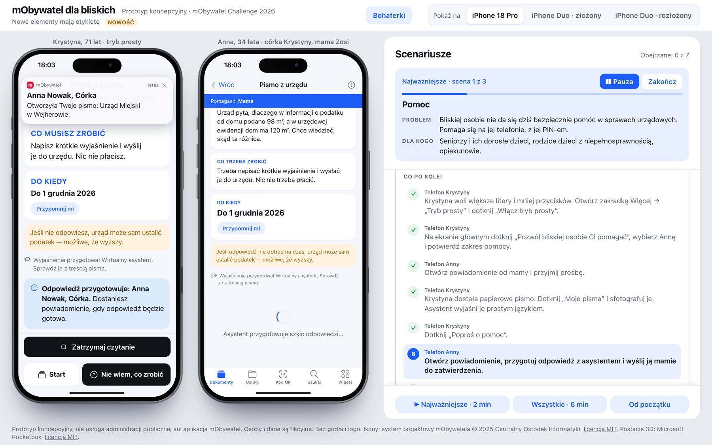
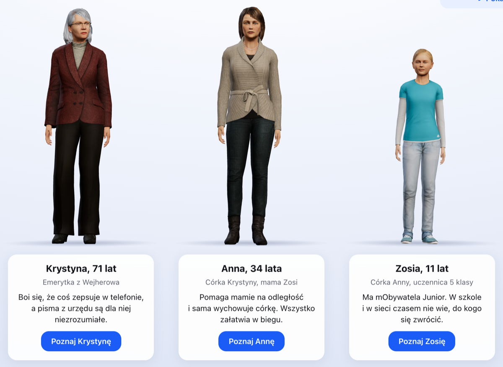
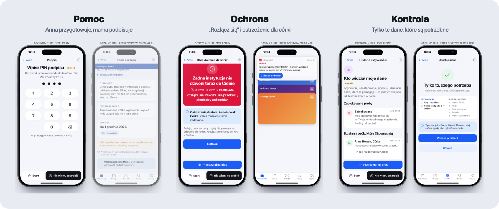

<p align="center">
  
</p>

<h1 align="center">mObywatel dla bliskich</h1>

<p align="center">
  Koncepcja mObywatela, w którym bliscy pomagają sobie w sprawach urzędowych bezpiecznie:
  ze zgodą, w ustalonym zakresie i z historią każdego kroku.
</p>

<p align="center">
  <a href="https://mobywatel-dla-bliskich-prototyp.vercel.app"><strong>Otwórz prototyp</strong></a>
  &nbsp;·&nbsp;
  <a href="#jak-obejrzeć">Jak obejrzeć</a>
  &nbsp;·&nbsp;
  <a href="#uruchomienie-na-własnym-komputerze">Uruchomienie</a>
</p>

<p align="center">
  <sub>Prototyp koncepcyjny na konkurs mObywatel Challenge 2026. Nie jest usługą administracji publicznej ani aplikacją mObywatel. Osoby i dane są fikcyjne.</sub>
</p>

<p align="center">
  
</p>

## O co chodzi

mObywatel dobrze działa dla jednej osoby. Sprawy urzędowe często załatwia się jednak w rodzinie: córka pomaga mamie z pismem z urzędu, babcia odbiera wnuczkę ze szkoły, rodzic podpisuje zgodę dla dziecka. Dziś robi się to na cudzym telefonie, z cudzym PIN‑em albo na kartce, której nikt nie sprawdzi.

Prototyp pokazuje, jak mObywatel może działać dla rodziny. Sprawa przechodzi między telefonami bliskich osób, a każda z nich widzi tylko swoją część.

## Bohaterki

Prototyp prowadzi przez sprawy jednej fikcyjnej rodziny: babci Krystyny (71 lat), jej córki Anny (34 lata) i wnuczki Zosi (11 lat).

<p align="center">
  
</p>

## Trzy filary: pomoc, ochrona, kontrola

<p align="center">
  
</p>

**Pomoc.** Krystyna włącza tryb prosty i daje Annie pozwolenie z określonym zakresem. Fotografuje papierowe pismo, a asystent wyjaśnia je prostym językiem. Anna przygotowuje odpowiedź na swoim telefonie, a Krystyna ją czyta i podpisuje PIN‑em. Bez mamy nic nie zostanie wysłane.

**Ochrona.** Dzwoni fałszywy policjant. Krystyna w trakcie rozmowy sprawdza w aplikacji „Ktoś do mnie dzwoni?” i dostaje jasną odpowiedź: rozłącz się. Anna w tej samej chwili dostaje ostrzeżenie. Prośby o logowanie, której Krystyna sama nie zaczęła, nie da się zatwierdzić.

**Kontrola.** Wypożyczalnia samochodów prosi o dane, a Anna wybiera jeden z trzech poziomów: samo potwierdzenie, dane podstawowe albo cały dokument. Ekran „Kto widział moje dane” zbiera w jednym miejscu udostępnienia, zablokowane próby oszustwa i działania osoby pomagającej.

### Kolejne pomysły dla całej rodziny

Ten sam wzorzec zgody i historii działa w innych sprawach rodziny:

- **Moje leki.** Kończy się lek. Krystyna prosi Annę o pomoc, Anna prosi przychodnię o receptę i widzi tylko ten jeden lek.
- **Odbiór dziecka ze szkoły.** Anna upoważnia babcię do odbioru Zosi, a nauczycielka sprawdza kod QR.
- **Ktoś do mnie pisze?** Obcy pisze do Zosi. Zosia dostaje radę i sama wybiera, komu o tym powiedzieć.
- **Zgoda dla szkoły.** Zosia skanuje kod z kartki od wychowawczyni, a Anna podpisuje zgodę w pracy.

## Jak obejrzeć

Najprościej otworzyć **[prototyp w przeglądarce](https://mobywatel-dla-bliskich-prototyp.vercel.app)**. Nie wymaga logowania.

- **Na komputerze** telefony stoją obok siebie, a obok jest panel ze scenariuszami. Każdy scenariusz opisuje problem, grupę osób, której dotyczy, i kolejne kroki.
- **Pokaz automatyczny** sam klika te same przyciski co człowiek i podświetla każde dotknięcie. „Najważniejsze” trwa około 2 minut (trzy filary), a „Wszystkie” około 6 minut (siedem scenariuszy). Pokaz można w każdej chwili zatrzymać.
- **Na telefonie** widać jeden telefon naraz, a zakładki Krystyna · Anna · Zosia przełączają osobę.
- **„Pokaż na”** w nagłówku zmienia urządzenie: iPhone 18 Pro albo składany iPhone Duo (złożony i rozłożony).

Wygląd odwzorowuje aktualną aplikację mObywatel. Nowe funkcje mają etykietę „Nowość”, a usługi, które już działają w mObywatelu, prowadzą do ekranu z tą informacją.

## Na czym się wzorujemy

| Pomysł w prototypie | Gdzie to już działa |
|---|---|
| Pomoc bliskiej osobie z określonym zakresem, terminem i historią | Suomi.fi (Finlandia): ogólnokrajowe pełnomocnictwa elektroniczne |
| Logowanie, które może zacząć tylko sam użytkownik | Smart-ID (Estonia) i MitID (Dania) |
| Różne poziomy pokazania dowodu | MiDNI (Hiszpania) |
| Ekran zgody i historia przekazanych danych | Singpass (Singapur) i Trust Exchange (Australia) |

## Asystent i polski model językowy PLLuM

W tej wersji asystent korzysta z przygotowanych wcześniej odpowiedzi do przykładowego pisma i nie łączy się z żadnym modelem językowym. Dzięki temu prototyp działa tak samo przez cały czas oceny konkursowej.

Połączenie z polskim modelem językowym PLLuM jest gotowe w kodzie, ale strona go nie wywołuje: wyjaśnienie pisma w trzech częściach (o co chodzi, co zrobić, do kiedy) i szkic odpowiedzi z faktami od bliskiej osoby. Kod jest w `api/assistant.js` i `api/_lib/pllum.js`, a szablon ustawień w `.env.example`.

## Uruchomienie na własnym komputerze

Wystarczy Node.js w wersji 18 lub nowszej. Prototyp nie ma żadnych zależności ani kroku budowania.

```bash
git clone https://github.com/fisieek/mobywatel-dla-bliskich.git
```

```bash
cd mobywatel-dla-bliskich
```

```bash
node dev-server.mjs
```

Następnie otwórz http://localhost:4173. Adres z `?prolog=0` pomija ekran z bohaterkami i od razu pokazuje telefony.

## Jak to jest zbudowane

- **HTML, CSS i JavaScript bez bibliotek i bez kroku budowania.** Jedyną biblioteką jest three.js do sceny z bohaterkami 3D. Wczytujemy ją z własnego serwera.
- **Telefony w prawdziwych wymiarach.** Wspólny stan pozwala wysyłać powiadomienia z jednego telefonu na drugi.
- **Prywatność.** Prototyp nie ma analityki ani zewnętrznych czcionek i nie pojawia się w wyszukiwarkach.
- **Dostępność.** Tryb prosty ma duże litery, mniej przycisków, czytanie na głos i przycisk „Nie wiem, co zrobić” na każdym ekranie.
- **Stały link dla jury.** Automatyczne sprawdzenie w GitHub Actions codziennie upewnia się, że prototyp otwiera się bez logowania.

| Folder lub plik | Co zawiera |
|---|---|
| `index.html` | Strona: telefony obok siebie i panel ze scenariuszami |
| `js/episodes.js` | Scenariusze: problem, grupa osób, bohaterki i kroki |
| `js/scenes/` | Przebieg każdego scenariusza na telefonach |
| `js/screens/` | Ekrany aplikacji mObywatel: Dokumenty, Usługi, Kod QR, Szukaj, Więcej |
| `js/postacie/` | Ekran startowy z bohaterkami 3D |
| `js/autoplay.js` | Pokaz automatyczny |
| `styles/` | Wygląd aplikacji, telefonów i ekranu startowego |
| `api/` | Funkcja serwerowa do połączenia z modelem PLLuM (nieużywana) |
| `narzedzia/` | Nagrywanie filmu z pokazu i przygotowanie postaci 3D |

Pełny opis plików i zasad pisania tekstów jest w [budowa.md](docs/budowa.md).

## Licencje i źródła

- **Kod prototypu:** licencja MIT, zobacz [LICENSE](LICENSE).
- **Ikony:** system projektowy mObywatela, © 2025 Centralny Ośrodek Informatyki, licencja MIT ([LICENCJA.txt](assets/ikony/LICENCJA.txt)). Prototyp nie zawiera godła ani logo dokumentów.
- **Postacie 3D:** biblioteka Microsoft Rocketbox, licencja MIT ([LICENCJA-Rocketbox.txt](assets/postacie/LICENCJA-Rocketbox.txt)).
- **three.js 0.170:** licencja MIT ([LICENSE](vendor/three/LICENSE)).

To nie jest kod aplikacji mObywatel ani prototypu przygotowanego przez organizatorów konkursu. Nazwa mObywatel należy do jej właściciela. Wszystkie osoby, pisma, instytucje i dane w prototypie są fikcyjne.

## Autor

Filip Stolarski · zgłoszenie do konkursu [mObywatel Challenge 2026](https://mobywatel.ai)
